# S7 PLC Side Panel

The **S7 PLC** page in the Home Assistant sidebar is where you add, edit, delete,
import and export every PLC entity. It combines a guided visual editor, a YAML
editor, live states and connection diagnostics in one place.

<p align="center">
  <picture>
    <source media="(prefers-color-scheme: dark)" srcset="images/sidepanel/overview-dark.png">
    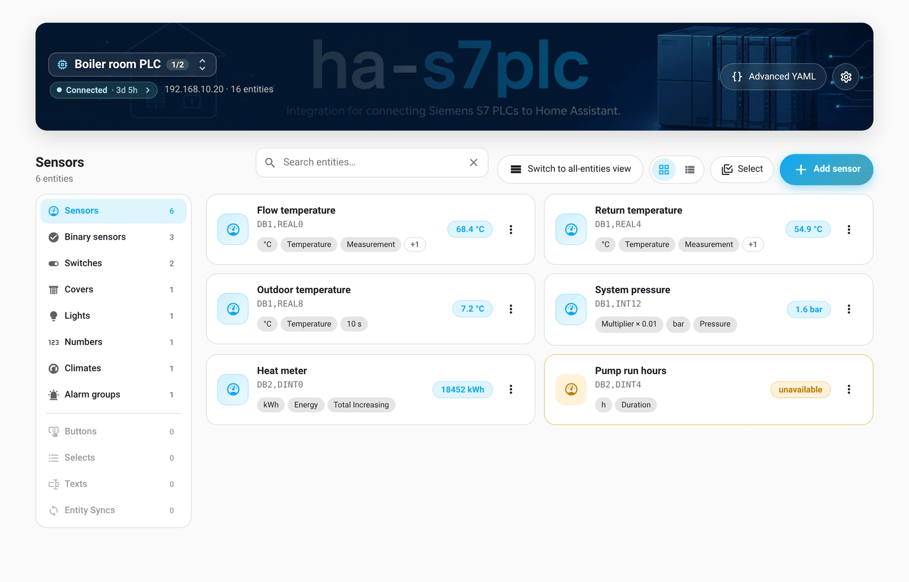
  </picture>
</p>

> [!IMPORTANT]
> Entity management through the legacy Entity Options Flow was removed in
> version **7.0.0**. The Side Panel is the only supported interface for
> managing entities.

## Contents

- [At a glance](#at-a-glance)
- [Opening the panel](#opening-the-panel)
- [The header](#the-header)
- [Finding entities](#finding-entities)
- [Entity cards](#entity-cards)
- [Adding and editing an entity](#adding-and-editing-an-entity)
- [Editing several entities at once](#editing-several-entities-at-once)
- [Advanced YAML](#advanced-yaml)
- [Deleting entities](#deleting-entities)
- [On a phone](#on-a-phone)
- [Side Panel vs. integration options](#side-panel-vs-integration-options)
- [Entity availability](#entity-availability)
- [Numeric comparison binary sensors](#numeric-comparison-binary-sensors)
- [Alarm groups](#alarm-groups)

## At a glance

| I want to… | Where |
|---|---|
| Switch to another PLC | Click the PLC name in the header (shown as a button with an `n/total` counter when several PLCs exist) |
| See whether the PLC is connected | Connection badge in the header; click it for the full diagnostics |
| Find an entity | Search field, or press <kbd>/</kbd> anywhere on the page |
| Add an entity | **Add &lt;type&gt;** button (for example **Add sensor**) |
| Edit an entity | Click its card |
| Duplicate or delete one entity | <kbd>⋮</kbd> menu on the card |
| Delete several entities | **Select**, pick the cards, then **Delete selected** |
| Compact list instead of cards | Grid/list toggle in the toolbar |
| Every type on one page | **Switch to all-entities view** |
| Back up or bulk-edit everything | **Advanced YAML** in the header |
| Change the default address editor | <kbd>⚙</kbd> settings menu in the header |

## Opening the panel

- The **S7 PLC** sidebar item appears after at least one S7 PLC config entry is
  loaded.
- The page is restricted to Home Assistant **administrators**.

If the item does not appear after installing or upgrading the integration,
restart Home Assistant and confirm that the S7 PLC integration loaded without
errors.

> [!NOTE]
> With no configured entities, the panel shows a note about
> [on-demand connections](configuration.md#on-demand-connections). A newly added
> PLC can show **Disconnected** even after a successful setup test: that test
> connection is temporary, and the operational connection opens when a read,
> write, or explicit health check is requested.

## The header

<p align="center">
  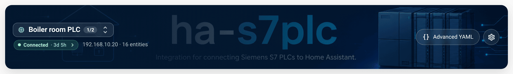
</p>

The header shows the selected PLC on top of the project banner:

- **PLC name**: with more than one PLC entry, the name becomes a switcher button
  showing the position (for example **1/2**). Click it to choose another PLC.
  Every change on the page applies only to the selected entry.
- **Connection badge**: **Connected**, **Disconnected** or **Unknown**, plus the
  current uptime. Click it to open the connection details.
- **Host and entity count** of the selected PLC.
- **Advanced YAML** opens the [complete configuration editor](#advanced-yaml).
- <kbd>⚙</kbd> opens the settings menu.

### Connection details

<p align="center">
  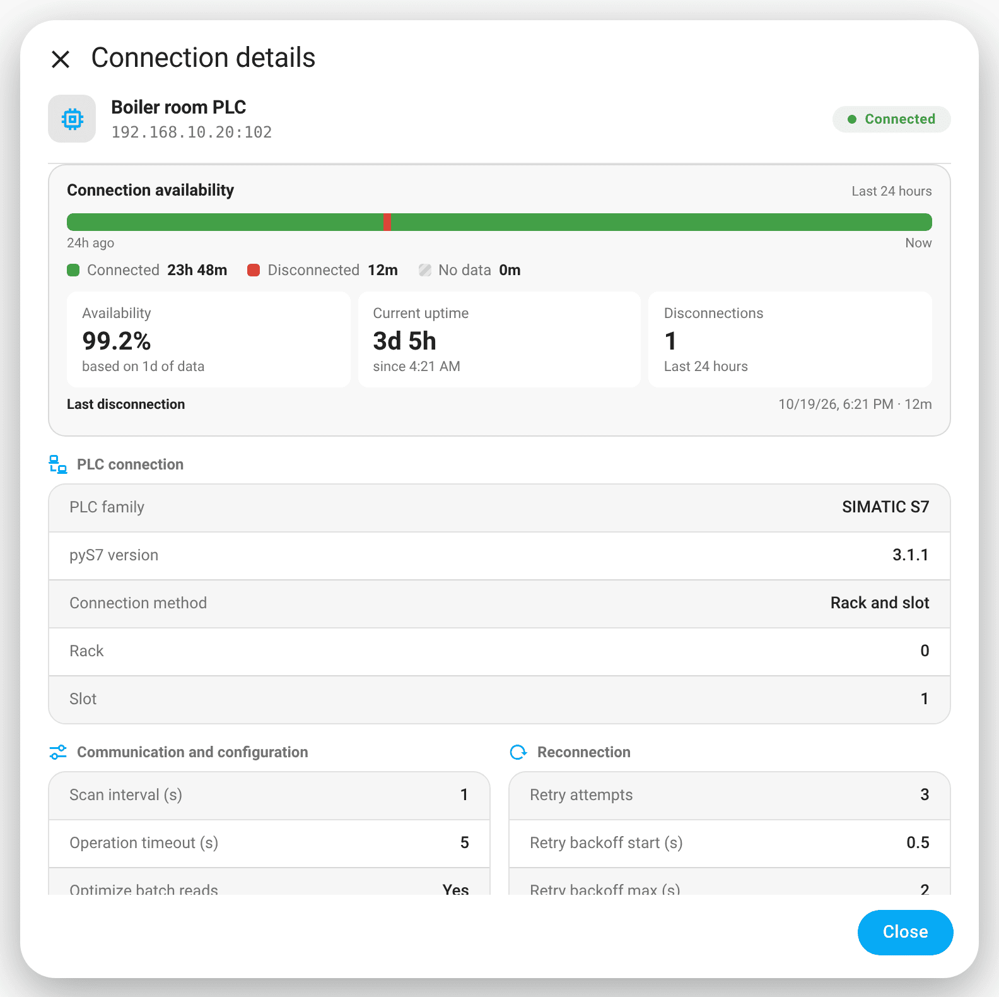
</p>

A read-only summary of the selected PLC:

- **Connection availability** over the last 24 hours. Green is connected, red is
  disconnected, and the striped grey parts are periods without data in the
  Home Assistant history. The legend shows how long each state lasted.
- **Availability** is calculated only on the time with data; the line below the
  percentage says how much data was used.
- **Current uptime** (or downtime) and when it started, and the number of
  **disconnections** in the last 24 hours.
- Every connection parameter: host, connection method, timing, retries and
  performance options.

### Settings menu

<p align="center">
  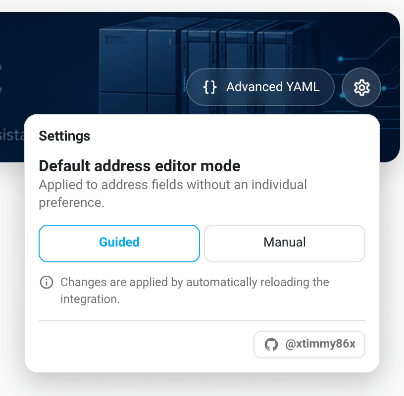
</p>

**Default address editor mode** chooses whether address fields open in the
**Guided** builder or in **Manual** text mode. It applies to every field you have
not switched yourself; switching a field remembers your choice for that field.
The preference is stored in the browser.

## Finding entities

The category sidebar lists every entity type with its count. Types without
entities are dimmed and grouped at the bottom. On narrower windows the categories
become a row of chips or a drop-down menu.

### Search

Type in **Search entities…**, or press <kbd>/</kbd> from anywhere on the page to
jump to the field. The search matches names, PLC addresses, options and the
current value. Press <kbd>Esc</kbd> to clear it.

<p align="center">
  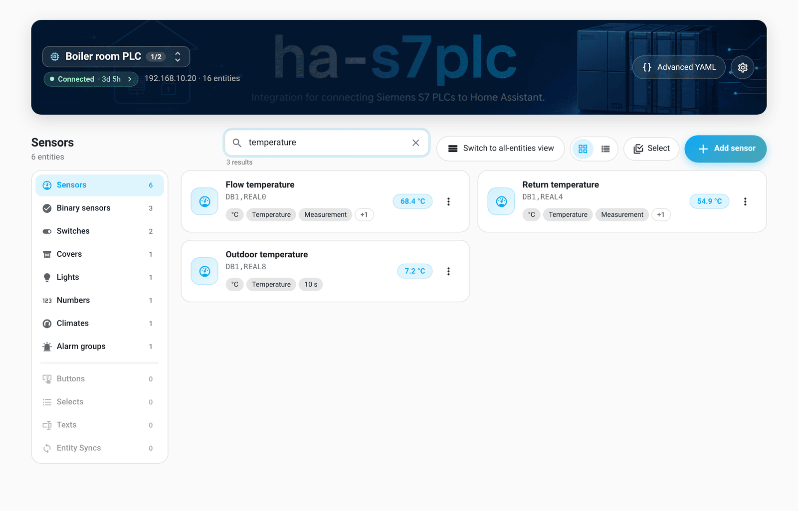
</p>

### Grid or list

The grid/list toggle in the toolbar switches between cards and a compact list
with one row per entity. The choice is remembered in the browser.

<p align="center">
  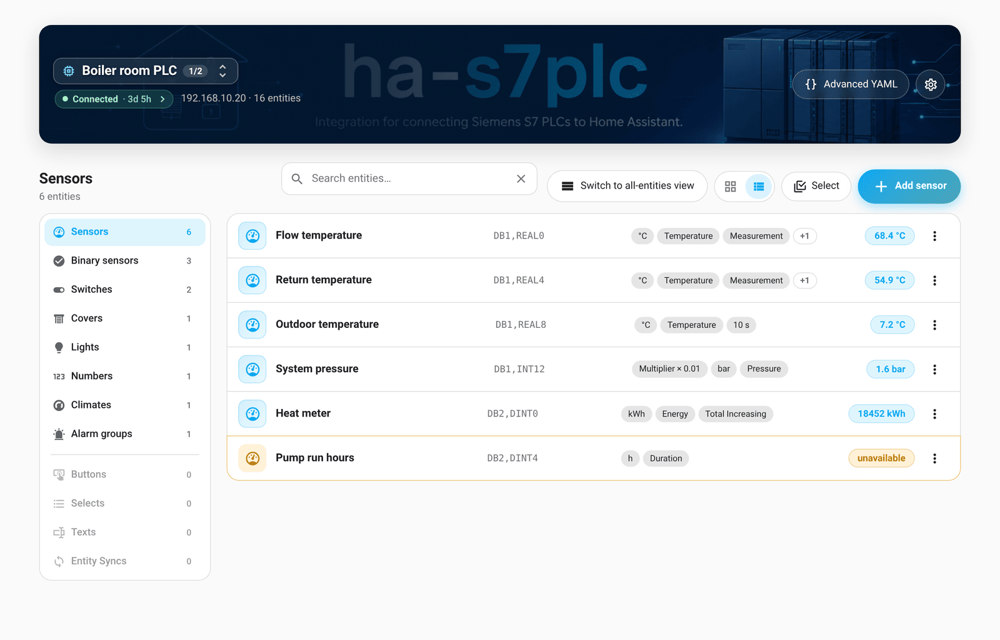
</p>

### All entities on one page

**Switch to all-entities view** places every type in expandable sections on one
page. Empty types collapse into a single row with their own **Add** button.
**Switch to category view** goes back to one type at a time. The layout is
remembered in the browser.

<details>
<summary>Screenshot: all-entities view</summary>

<p align="center">
  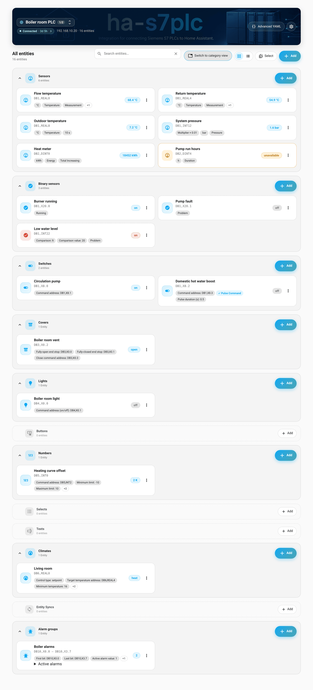
</p>

</details>

## Entity cards

<p align="center">
  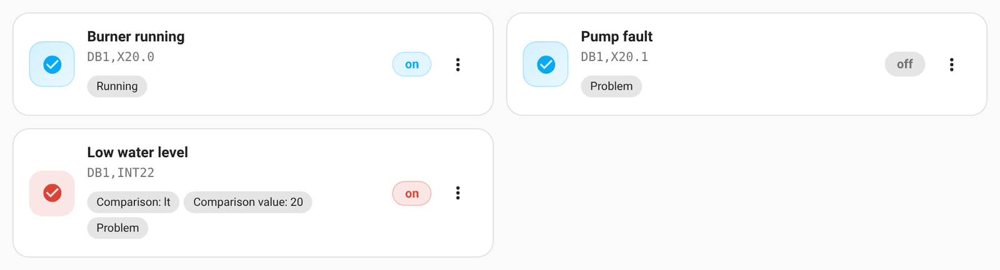
</p>

Each card shows:

- the name and the main PLC address;
- the most useful settings as short chips (unit, device class, scan interval,
  conversions). Hover a chip for its full label; **+N** means more settings are
  configured;
- the current Home Assistant state.

The state colour tells you what needs attention:

| Colour | Meaning |
|---|---|
| Blue | Normal value |
| Grey | Off, closed or idle |
| Orange (card outlined) | `unavailable` or `unknown`: check the PLC connection or the address |
| Red | A problem-type binary sensor (problem, safety, smoke, gas, moisture…) is **on** |

**Click a card** to edit it. The <kbd>⋮</kbd> menu offers **Edit**, **Duplicate
entity** and **Delete**.

<p align="center">
  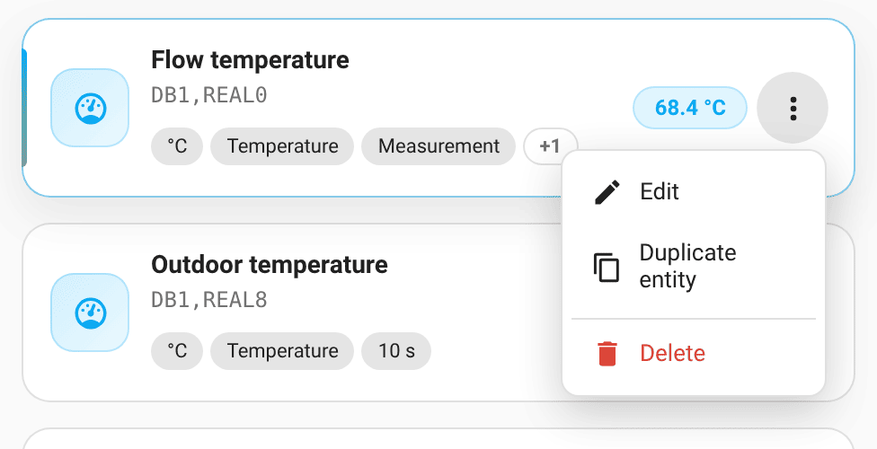
</p>

The internal entity UID is deliberately not displayed or edited. It is preserved
by the backend when an entity is updated, including updates made in YAML mode, so
changing an address does not create a new Home Assistant entity identity.

## Adding and editing an entity

1. Open **S7 PLC** in the sidebar and select the PLC.
2. Pick the entity type in the category sidebar.
3. Choose **Add &lt;type&gt;**, or click an existing card.
4. Fill in the form (**Visual**) or switch to **YAML** for advanced editing.
5. Choose **Save changes**.

Saving updates the selected config entry. The following edits apply immediately
without reloading the integration or reconnecting to the PLC:

| Entity | Settings applied live |
|---|---|
| Sensors and numbers | Numeric value conversion (including multiplier), scan interval, REAL precision, device class and unit of measurement |
| Sensors | State class (Automatic, None or an explicit class) |
| Binary sensors and covers | Device class |
| Numbers | Minimum, maximum, step and display mode (auto, box or slider) |
| All entity types | Area assignment |

Numeric conversions recalculate the cached PLC sample immediately. Number writes
use the new conversion from the next command; saving does not write to the PLC.
REAL precision takes effect on the next reading. A manually disabled PLC
connection stays disabled.

Metadata changes preserve the entity IDs and respect compatible Home Assistant
unit and display-precision preferences. Incompatible display units are ignored
without deleting the saved preference. Clearing the device class removes it;
clearing the unit restores the class default (or no unit when no class is set).
**Automatic** derives a sensor's state class from its device class; **None**
explicitly removes the state class. Invalid combinations are rejected before
saving. TIME entities always use duration and seconds; enum mappings determine
their own metadata. Changes apply to future states and do not migrate historical
statistics. After changing a quantity or its unit, check Home Assistant's
statistics tools if existing long-term statistics need correction.

Adding or deleting entities, changing PLC addresses or connection settings,
changing enum mappings, and edits outside the table still reload the entry.
Changes to disabled entities also use the reload path, except for area assignment.
If a save combines live and structural edits, the entire save uses one reload.
These rules also apply to whole-configuration YAML saves. The page refreshes its
cards and live states after saving.

If you close the editor (**Cancel**, <kbd>Esc</kbd> or a click outside the
dialog) after changing something, the panel asks whether to **Keep editing** or
**Discard changes**, so a long form is never lost by accident.

<p align="center">
  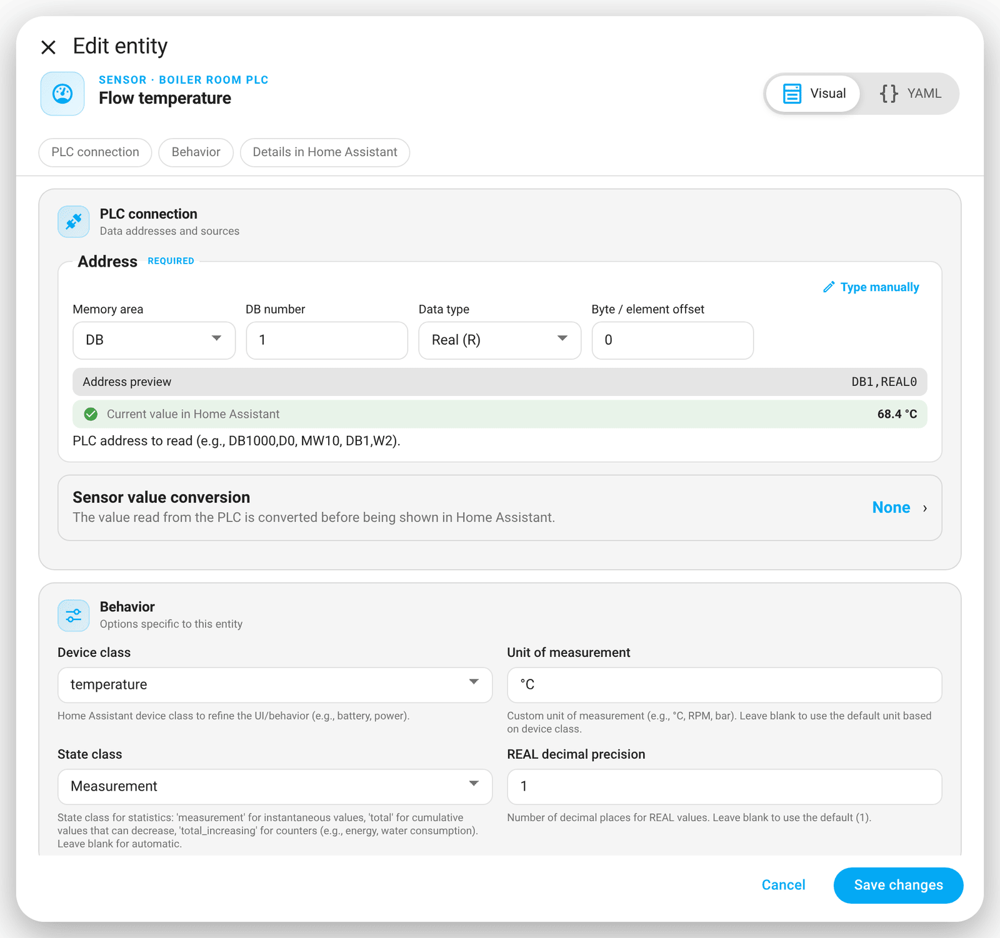
</p>

The editor header names the entity type, the PLC and the entity. Below it, the
section shortcuts jump straight to each part of a long form. The form groups the
fields into:

- **PLC connection**: addresses and data sources;
- **Behavior**: options specific to the entity type;
- **Details in Home Assistant**: name, area, scan interval and availability.

The visual editor supplies labels, help text, choices and historical defaults. It
performs only simple browser-side required-field checks; the backend validator
remains authoritative for PLC addresses and duplicate Climate preset/status
mappings.

### Address fields

Every PLC address has two modes:

| Mode | How it works |
|---|---|
| **Guided** (builder) | Choose memory area, DB number, data type, offset and bit. The **address preview** shows the result, for example `DB1,REAL0`. |
| **Manual** | Type the address directly, for example `DB1,X8.0`. |

Use **Type manually** or **Use builder** on each field to switch. Addresses the
builder cannot represent stay in manual mode with an explanation.

When you edit an existing entity, the main address also shows its **current
value in Home Assistant**, so you can confirm you are pointing at the right PLC
data. The line disappears as soon as you change the address.

Invalid or incompatible addresses are rejected instead of being stored. See the
[S7 Addressing Reference](addressing.md) for the complete syntax and alignment
rules.

<details>
<summary>Screenshot: a switch with one address in manual mode</summary>

<p align="center">
  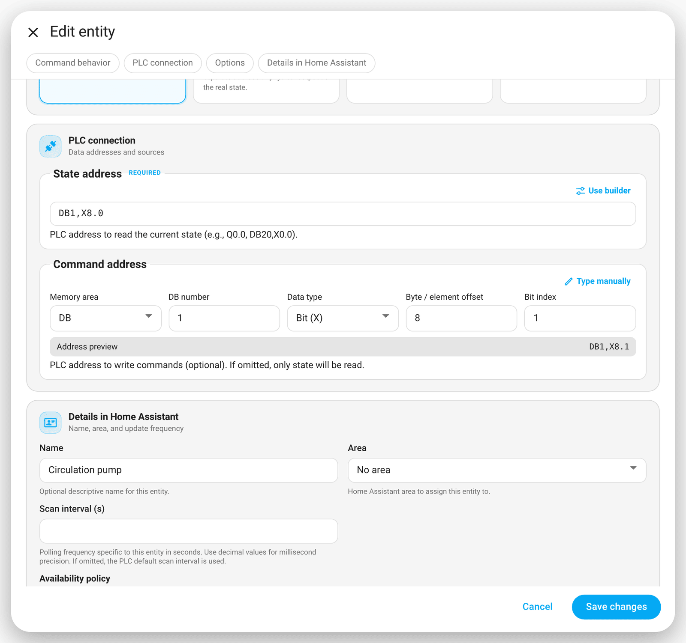
</p>

</details>

### Value conversions

Numeric addresses can convert values between the PLC and Home Assistant
(multiplier, linear scale, enumerations, custom expressions). Open the conversion
row under the address to configure it; the summary on the card shows the active
conversion. See [Value Conversions](value-conversions.md).

<details>
<summary>Screenshot: a multiplier conversion</summary>

<p align="center">
  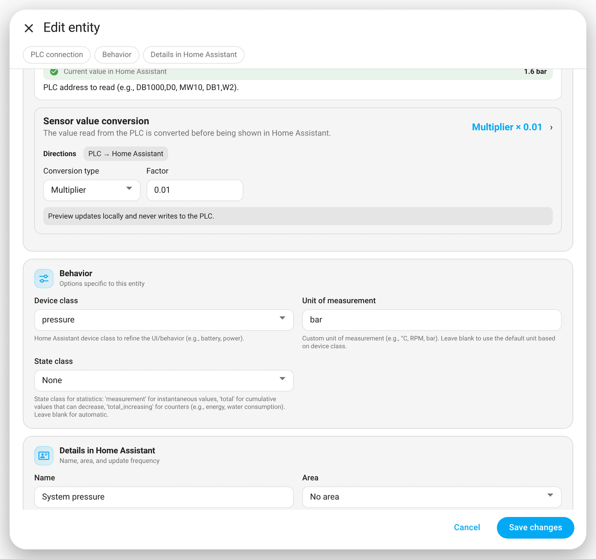
</p>

</details>

### Guided choices for switches, lights, covers and climates

<p align="center">
  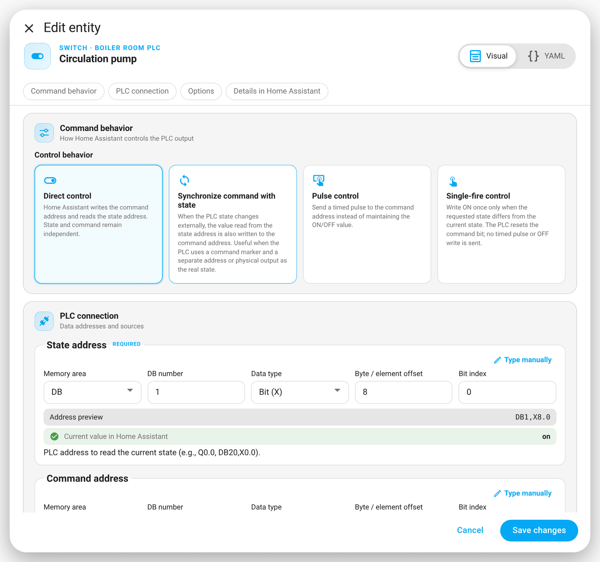
</p>

Switches and lights start with the **command behavior** (direct, synchronized,
pulse or single-fire control). The cover editor shows only the fields compatible
with the selected control type, position feedback, movement feedback, stop
command and (for position covers) tilt. These guided choices are derived from
existing configuration keys and do not add YAML properties.

The Climate editor separates direct Home Assistant regulation from PLC setpoint
regulation, then guides the choice of heating/cooling outputs, optional
direct-action bits, setpoint power and coded-mode commands, and operating-status
feedback. Existing entities are projected onto these choices from their stored
addresses; the choices themselves are never written to YAML.

> [!TIP]
> **HVAC mode command/readback** and **operating status** are deliberately
> separate:
>
> - Mode mappings decide which requested modes Home Assistant exposes and, when a
>   coded mode address is configured, which number it writes. Optional mode
>   readback reads the selected mode from that same address.
> - Operating-status feedback reports what the equipment is actually doing, such
>   as heating, cooling, idle, drying or defrosting. It can be inferred from
>   temperatures or read from its own coded PLC status address.
>
> The two PLC addresses may be identical when that matches the PLC program, but
> their meanings remain independent. Hidden legacy mappings are retained when
> feedback is temporarily disabled, including explicit empty and disabled values.

### YAML mode for one entity

<p align="center">
  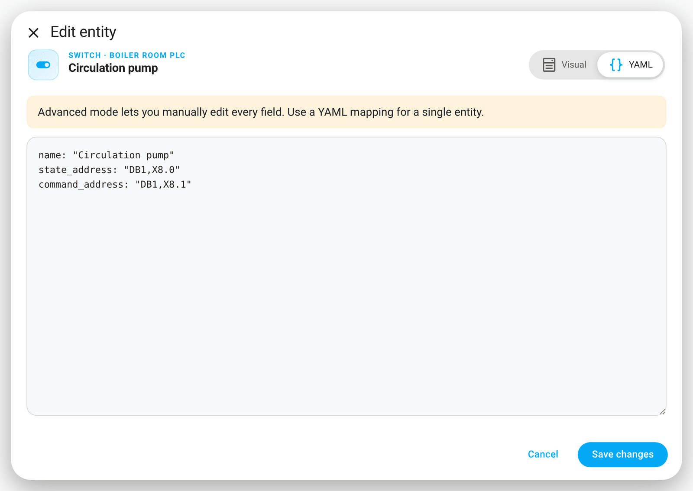
</p>

YAML mode edits one entity as a mapping of configuration keys to values. It is
useful for copying a complex entity or changing fields not shown in the guided
view.

```yaml
name: "Living room temperature"
address: "DB1,REAL4"
unit_of_measurement: "°C"
scan_interval: 2
real_precision: 1
```

YAML mode is not an unrestricted bypass. Before saving, the backend:

- requires a YAML mapping (not a list or scalar);
- allows only fields supported by the selected entity type;
- validates value types and required fields;
- validates PLC address syntax and entity-specific address types;
- preserves the existing UID when editing an item and assigns one when adding;
- rejects invalid or ambiguous climate mappings.

Errors are shown in the editor and the existing configuration remains unchanged.

> [!CAUTION]
> Prefer the visual editor unless you understand the stored entity schema:
> omitted optional YAML keys may remove their previous values.

## Editing several entities at once

Choose **Select** in the toolbar. Checkboxes appear on the cards and clicking a
card now selects it instead of opening the editor. The bar at the bottom shows how
many entities are selected; **Delete selected** removes them after confirmation,
**Edit selected** opens the [bulk editor](#editing-several-entities), and
**Cancel** (or **Done**) leaves selection mode.

<p align="center">
  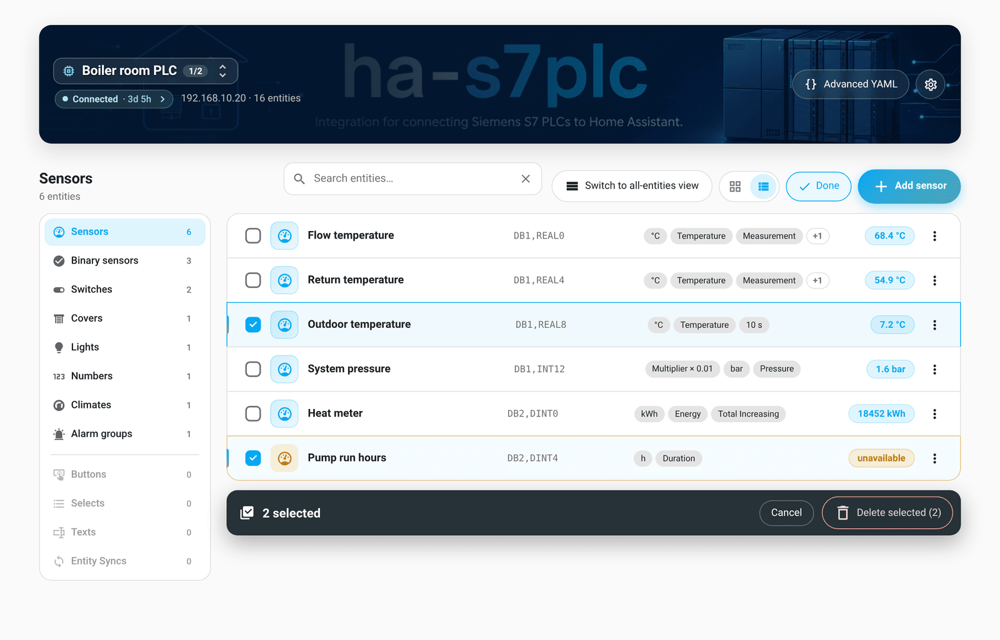
</p>

In the all-entities view you can select entities of different types together.

## Advanced YAML

<p align="center">
  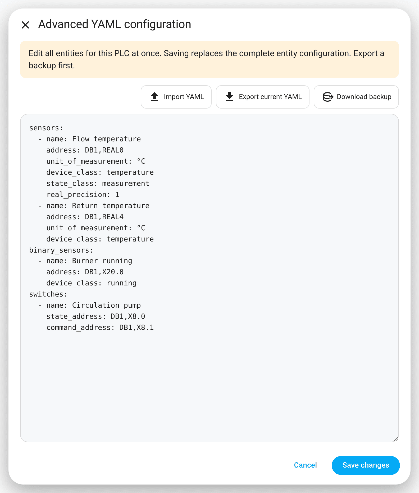
</p>

**Advanced YAML** in the header edits every entity of the selected PLC in one
document. The top-level mapping contains one list per entity type (`sensors`,
`binary_sensors`, `switches`, and so on). Saving validates every item before
replacing the entity configuration; if any item is invalid, none of the changes
are applied. Options unrelated to entity lists are retained.

| Button | What it does |
|---|---|
| **Import YAML** | Loads a `.yaml`/`.yml` file into the editor. Nothing changes until you choose **Save changes**. |
| **Export current YAML** | Downloads the document currently shown in the editor. |
| **Download backup** | Downloads the configuration currently stored in Home Assistant. |

> [!WARNING]
> Saving replaces **all** entity lists. Export a backup before making bulk
> changes.

Valid UIDs are retained when restoring to the same config entry. When importing
into another config entry, or when UIDs are missing or duplicated, safe UIDs are
generated. The YAML document backs up entities only, not connection settings.

## Editing several entities

1. Choose **Select**, then select the entities. In the all-entities view, the
   selection can span categories; search filters do not add unselected entities.
2. Choose **Edit selected**. For each setting choose **Leave unchanged**, set a
   new value, or remove the override. Open **Values and metadata** to edit
   multipliers, decimal places, device classes, units, and state classes.
3. Choose **Preview changes** to see the current and proposed settings for every
   selected entity, including unchanged rows. No configuration is saved yet.
4. Choose **Apply changes** to save the entire selection once.

Scan intervals accept fractional seconds from 0.05 to 3600. Buttons and entity
syncs do not have a configurable scan interval: their preview says **Not
applicable**, while area edits still apply. Areas refer to the assignments in
this integration's configuration. Restoring the PLC default removes the entity
scan override; the preview displays the inherited interval.

The editor offers a field when at least one selected entity supports it and
shows how many entities it applies to. Unsupported fields show **Not applicable**
in the preview and leave that entity unchanged.

| Setting | Applies to | Removing the override |
|---|---|---|
| Multiplier | Numeric sensors and numbers with compatible read/write addresses | Removes the numeric value conversion. |
| Decimal places | Sensors and numbers reading REAL or LREAL values; accepts 0–6 | Restores the default of one decimal place. |
| Device class | Numeric sensors, numbers, binary sensors, and covers | Restores the integration's automatic class, where applicable. |
| Unit of measurement | Numeric sensors and numbers | Restores the automatic unit for the device class, shown in the preview. |
| State class | Numeric sensors | **Automatic** restores the class-dependent default; **None (disable statistics)** explicitly disables statistics. |

Enum sensors retain their conversion and metadata. LOGO! time conversions are
also protected from multiplier edits. Replacing or removing an existing linear
scale or expression shows the current conversion and a warning in the preview.
Multipliers must be finite; zero is accepted for read-only sensors but rejected
for writable numbers because their inverse conversion would be undefined.
Changing a unit label does not convert values; set a multiplier too if needed.

Device classes, units, and state classes are checked together for each entity.
For example, a temperature class with volts as its unit prevents the entire
selection from being saved. The preview identifies the affected entities and
errors so you can correct the settings and preview again.

The backend validates all permanent entity identities and requested settings
before saving. Unrelated entity options are preserved. If the configuration
changes while reviewing the preview, generate a new preview; a stale preview
cannot overwrite those changes. Invalid selections or deleted areas leave all
entities untouched. Repeated clicks while a request is running do not submit it
again. Closing the dialog before applying leaves the configuration unchanged.

Area updates, the supported value and metadata changes above, and supported scan
changes use the live-update path described above. A selection containing scan
edits that require reloading causes a single reload for the whole save. An
unchanged selection performs no update or reload. Editing these settings does
not issue commands to the PLC.

## Deleting entities

Use **Delete** in the card's <kbd>⋮</kbd> menu, or select several cards and use
**Delete selected**. Confirm the dialog to remove them.

The panel sends the complete selection as one request, using permanent entity
identities. The backend validates the entire selection before saving once and
reloading once, including selections across categories. If an entity in the
selection no longer exists, nothing is deleted: close the dialog, refresh and
select again. Other errors remain visible in the dialog and can be retried.

> [!CAUTION]
> Deletion is immediate and cannot be undone. Export the configuration first if
> you might need to restore it; see
> [Export and Import](configuration.md#export-and-import).

## On a phone

<table>
  <tr>
    <td align="center" width="50%">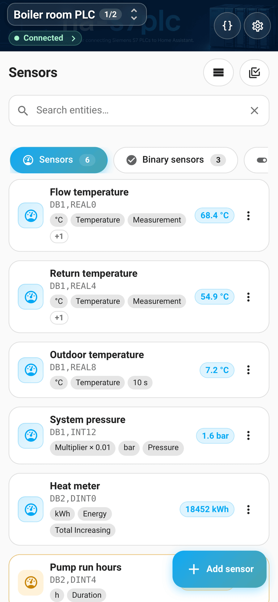</td>
    <td align="center" width="50%">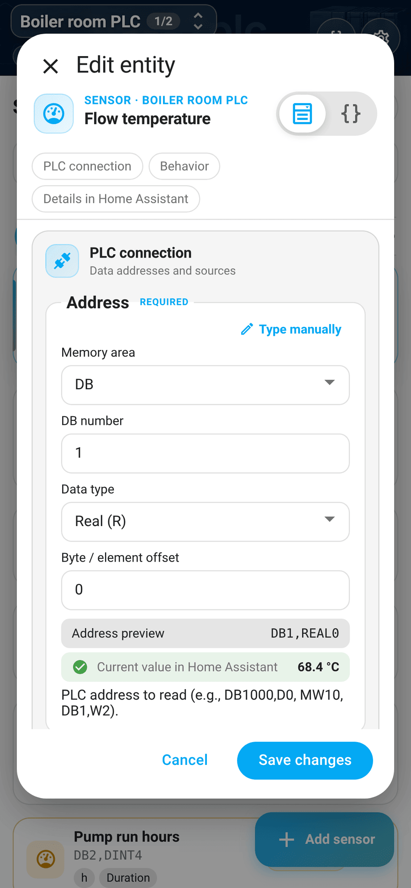</td>
  </tr>
</table>

On small screens the header becomes a bar that stays at the top while you scroll
and includes the Home Assistant menu button. Categories become a scrollable row
of chips, the actions show icons only, and **Add** floats at the bottom right.
The editor stacks every field in a single column.

## Side Panel vs. integration options

The initial Config Flow still adds a PLC, and **Settings → Devices & Services →
S7 PLC → Configure** still opens the Options Flow for connection settings. Neither
is an entity editor since version 7.0.0.

| Function | Interface |
|----------|-----------|
| Add a PLC | Initial Config Flow |
| Modify the connection | Integration **Configure** / Options Flow |
| Add or modify entities | Side Panel |
| Delete entities | Side Panel |
| Back up and restore entities | Side Panel → Advanced YAML |
| Connection diagnostics and status | Side Panel → connection badge |

## Entity availability

Every configurable entity editor includes an **availability policy** in
**Details in Home Assistant**:

| Policy | Behavior |
|---|---|
| **Follow PLC connection** (default) | The entity follows the PLC connection and the availability of its required data. Preserves the existing behavior. |
| **Always available** | Keeps the last state visible (which may be stale), but cannot bypass command connection checks. |
| **PLC availability bit** | Shows a required BIT address. The entity is available only when its normal data is valid, the PLC is connected and the bit is true. |

Switching away from the bit policy removes its address. The same fields are
supported by the visual and YAML editors.

## Numeric comparison binary sensors

<p align="center">
  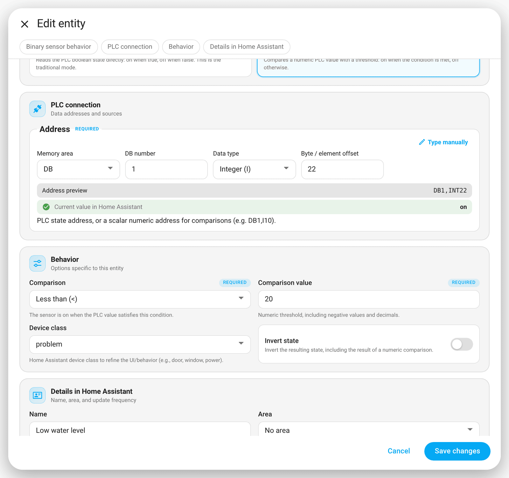
</p>

In **Binary sensors**, add or edit an entity and select **Numeric comparison**
under **Binary sensor behavior**. Enter a scalar numeric PLC address (for example
`DB1,I10`), a comparison operator and a numeric threshold. Supported operators are
equal, not equal, greater than, greater than or equal, less than, and less than or
equal. Negative and decimal thresholds are supported. The comparison uses the raw
PLC value; equality is exact (there is no tolerance or hysteresis).

For example, this entity is on above 15 and off at or below 15:

```yaml
name: Value above 15
address: DB1,I10
comparison_operator: gt
comparison_value: 15
```

- **Supported address types:** BYTE, WORD, DWORD, SINT, USINT, INT, DINT, REAL
  and LREAL. BIT, strings, TIME and arrays cannot be used for numeric comparisons.
- **Missing or non-finite readings** produce an unknown state, not a false
  comparison result; connection availability follows the entity's configured
  availability policy.
- **Invert state** inverts the comparison result. Device class and scan interval
  work as for other binary sensors.
- Existing sensors keep their direct-state behavior; switching back to **Boolean
  state** removes the comparison settings.

Multiple binary sensors may compare the same PLC address using different
operators, thresholds or inversion settings, and a numeric sensor may read that
address too. Identical comparison rules are rejected as duplicates; direct-state
binary sensors retain the one-per-address restriction.

<details>
<summary>Polling of shared comparison addresses</summary>

Each comparison keeps its own polling interval and cached feedback. When several
entities are due in the same polling cycle, the PLC tag is read once and the value
is distributed to all of them. Different intervals may require reads in separate
cycles. Removing or editing one comparison does not replace another's settings.

</details>

## Alarm groups

Use **Alarm groups** to monitor a contiguous range of DB or M (merker) bits without
creating an entity for every alarm. A group creates one sensor with the active
count and one `problem` binary sensor that is on while at least one included alarm
is active.

<p align="center">
  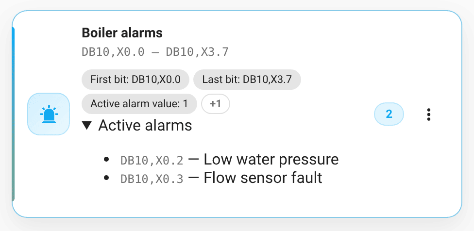
</p>

### Defining the range

<p align="center">
  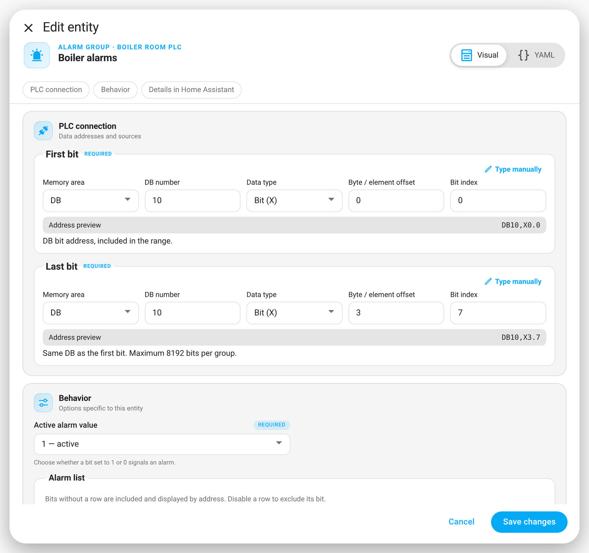
</p>

For example, configure the first bit as `DB1,X0.0`, the last bit as `DB1,X100.7`,
and the active value as **1**. Both endpoints are included: this is 808 bits in
101 bytes. Start/end bits may be anywhere within a byte, but must belong to the
same DB and be in ascending order. A group supports up to 8192 bits. Choose **0**
for active-low alarm lists and set the scan interval in Home Assistant details.

Alarm flags kept in the M (merker) area work the same way. For example, set the
first bit to `M8.0` and the last bit to `M9.7` to monitor 16 flags in 2 bytes.
Both endpoints must be in the same area, so a range cannot mix `M` and `DB`
addresses. Description and exclusion rows must use addresses in that same area
(for example `M8.1`). Input and output areas are not supported.

### The alarm list

<p align="center">
  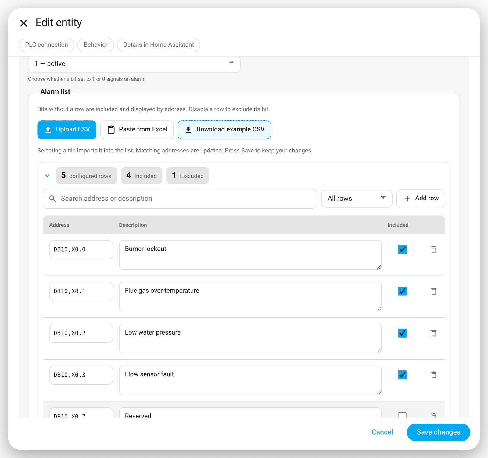
</p>

All bits are included initially. In **Alarm list**, add rows only for descriptions
you want to customize or bits you want to exclude. Uncheck **Included** for
reserved/unused bits. Bits without a description use their PLC address. Excluded
bits affect neither the count nor the presence sensor.

| Action | Result |
|---|---|
| **Download example CSV** | A ready-to-edit file with two included alarms and one excluded bit (DB1 bits 0.0–0.2; adjust the addresses to your range). |
| **Upload CSV** | Reads a file directly into the list. |
| **Paste from Excel** → **Import rows** | Imports a table pasted from a spreadsheet. |

A message confirms the imported, added and updated row counts. The summary counts
configured, included and excluded rows (not currently active PLC alarms). Review
them with address/description search, the inclusion filter and 50-row pages.
Editing or deleting a visible row preserves rows on other pages. **Save** commits
the whole list; cancelling discards the edits.

<details>
<summary>How the collapsible list behaves</summary>

The editable list starts collapsed; click its summary counts to expand or collapse
the search, filters, rows and pagination. Import controls and results stay
visible. A successful import opens the list for review. Saving with an incomplete
row also opens the list and reveals the affected page. Collapsing preserves edits,
search, filters and the current page; the expanded table has a bounded scrollable
height. An invalid import preserves the existing list and its expanded/collapsed
state.

</details>

#### CSV format

Columns are `address`, `description`, and optional `enabled` (`1`/`true` to
include, `0`/`false` to exclude). The English column header is optional.
Addresses accept DB bits (`DB1,X0.0` or `DB1,0.0`) and M bits (`M0.0`).
Semicolon CSV and tab-separated text allow unquoted PLC addresses. Comma-separated
CSV requires quoting DB addresses because they contain a comma; M addresses can
be unquoted. Imported rows update matching table rows and preserve others.
Equivalent address spellings are normalized before matching or detecting
duplicates. Invalid bit addresses, duplicate addresses within one import, and
descriptions longer than 255 characters leave the list unchanged. Saving also
checks that every address belongs to the group's area and configured range.

```csv
address;description;enabled
DB1,X0.0;Motor overload;1
DB1,X0.1;Low pressure;1
DB1,X0.2;Reserved;0
```

For a group covering `M0.0`–`M1.7`, a comma-separated file can contain:

```csv
address,description,enabled
M0.0,Motor overload,1
M0.1,Low pressure,1
M1.7,Reserved,0
```

### Active and last alarm

The group card's **Active alarms** list updates from the count sensor's
`active_alarms` attribute, containing objects with `address` and `description`.
This potentially large list is excluded from recorder history; count and presence
states remain recordable. Missing or invalid samples are not interpreted as zero
alarms. The usual availability settings also apply; **Always available**
explicitly permits restoring the last sample while the PLC is offline.

The count sensor also exposes:

| Attribute | Content |
|---|---|
| `last_alarm` | Description, falling back to the bit address |
| `last_alarm_address` | Bit address |
| `last_alarm_at` | UTC detection time |

They start as `null`. Newly active bits are displayed one at a time for two
seconds, in reception order. Each newly activated alarm is displayed exactly once:
for example A, B, C, then C remains visible. This is not a repeating rotation of
the currently active list.

<details>
<summary>Display queue details</summary>

Bits first observed in the same sample use ascending bit address order, since a
sampled range cannot reveal their actual activation order. All alarms in that
sample have the same detection timestamp. Further activations join the display
queue, including a bit that clears and later activates again. Repeated samples of
still-active bits and alarm clearances do not restart the sequence. Only a new
activation adds an entry. The final alarm remains visible after the queue drains,
even when all bits clear. The count and `active_alarms` always reflect the current
sample immediately.

These three small attributes are recordable. The last displayed alarm is restored
on restart for an unchanged range; the pending display queue is not restored, and
the first valid sample establishes a baseline without replaying already-active
bits. For a newly added group, active bits in its first live sample are displayed.
Invalid readings and disconnects retain the last alarm and do not clear the
remembered active bits. The queue holds up to 8192 pending occurrences; in an
overload it discards the oldest pending entries and logs a warning. Display timers
are cancelled when the entity is removed. This display queue is not a permanent
alarm journal.

</details>

For example, a dashboard Markdown card can show the most recently displayed alarm:

```yaml
type: markdown
content: >-
  {{ state_attr('sensor.plc_profila_fermapiedi_allarmi', 'last_alarm')
     or 'Nessun allarme ricevuto' }}
```

### Reads and limits

Both entities share the same scheduled byte-block reads. The 101-byte example uses
one block tag. Larger ranges are split into blocks of at most 200 bytes to fit the
minimum supported PDU. pyS7 handles packing these tags into requests; identical
block tags due in the same cycle are deduplicated. A large range can require
multiple PLC requests and is not an atomic PLC snapshot.

> [!IMPORTANT]
> This feature reports the current sampled alarm bits. It does not acknowledge,
> reset, write or latch PLC alarms. A pulse occurring entirely between polls can
> be missed; latch such alarms in the PLC when they must remain observable.

Group configuration, descriptions and exclusions are included in normal
configuration exports/backups.

### YAML examples

<details open>
<summary>Single group using the M area</summary>

```yaml
name: Boiler room alarms
start_address: M8.0
end_address: M9.7
active_value: 1
alarms:
  - address: M8.1
    description: 3-way valve low temperature
    enabled: true
  - address: M8.6
    description: Reserved
    enabled: false
```

</details>

<details>
<summary>Single group using a DB</summary>

```yaml
name: Machine alarms
start_address: DB1,X0.0
end_address: DB1,X100.7
active_value: 1
scan_interval: 1
alarms:
  - address: DB1,X0.0
    description: Motor overload
    enabled: true
  - address: DB1,X0.2
    description: Reserved
    enabled: false
```

</details>
